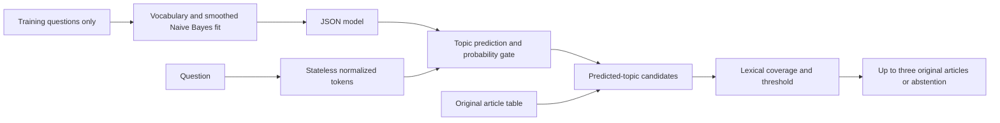

# Architecture

Python 3.10+, NumPy, Flask; uv.lock resolves runtime and development dependencies. No database or network call during application use. Models are JSON, not executable serialized objects. Project source, templates and static CSS are included in the wheel.

Schemas validate records and cross-file references before operation. NFKD/casefold/accent removal and alphanumeric tokenization create separate search representations, retaining original article text. Vocabulary is sorted and learned exclusively from training questions. Multinomial Naive Bayes estimates class priors from example counts and token likelihoods using add-one smoothing. Prediction sums log priors and count-weighted log likelihoods, then uses a numerically stable softmax. Unknown tokens contribute nothing; an all-unknown query has probability zero and abstains.

This baseline is small, inspectable and appropriate for a Pi target, with unverified hardware compatibility. It assumes conditional token independence and may be overconfident, miss synonyms, confuse topics or fail on questions covering multiple topics. No learned embeddings or pretrained model is used.

Ranking is query-token coverage: unique overlapping article tokens / unique query tokens. Only predicted-topic articles with positive overlap and score at least the lexical threshold qualify. Sort descending score, then lexicographically by text article ID; display the first three. If a topic has fewer than three useful candidates, return only those. Never expand across topics. No lexical matches or failed probability gate yields exactly the specified fallback. Empty/punctuation-only queries request a question.

The default gates (topic 0.55, lexical 0.15) are synthetic demo settings. Neither score is validated confidence. Select thresholds and any tokenization/ranking changes using real development data only, then freeze before independent evaluation. Missing/invalid/stale artifacts and invalid datasets produce actionable CLI errors before web startup. Jinja autoescaping displays regulation text as text, preserving line breaks, without interpreting HTML.

Evaluation counts hits against displayed results, so abstentions are misses. Unix measurement code records warm in-process search latency and process lifetime peak RSS; it excludes HTTP and is not a cold-start benchmark. No Raspberry Pi performance has been established.
